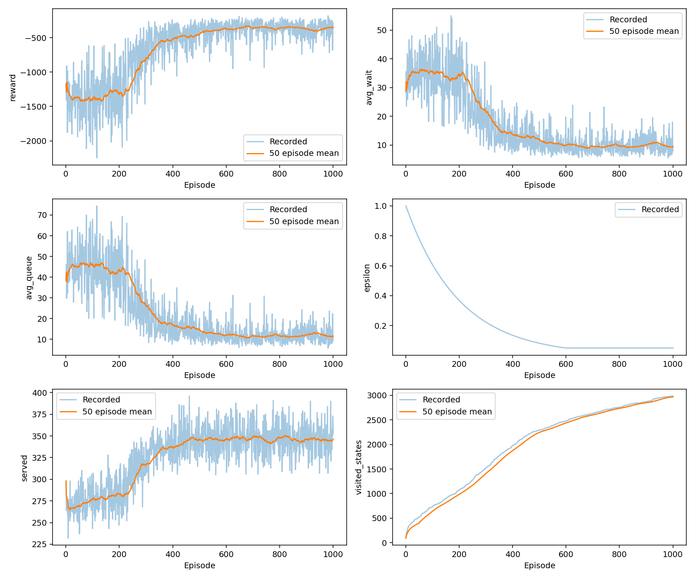
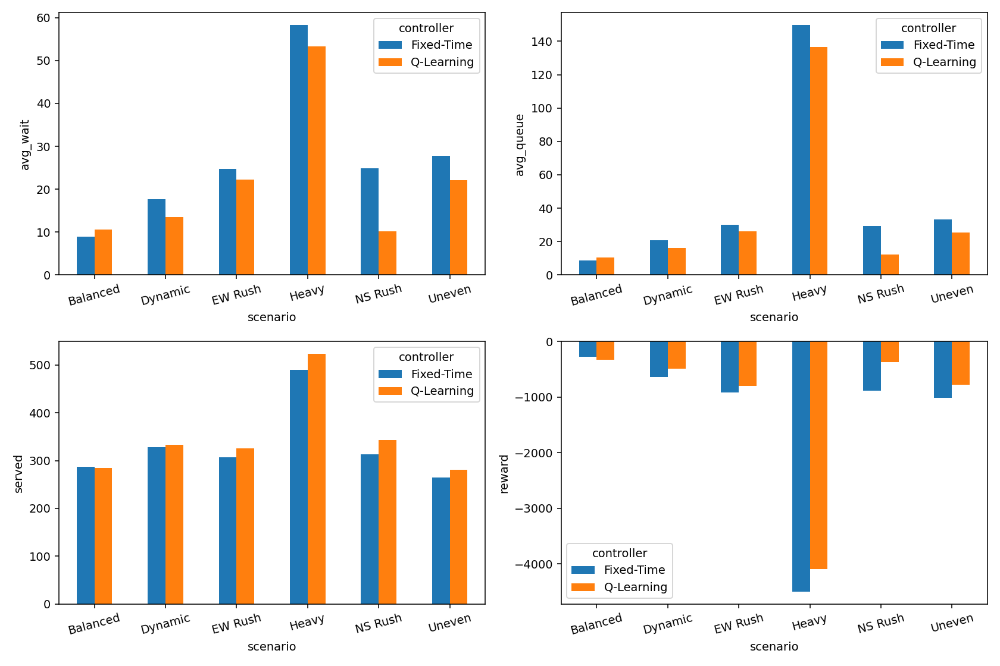

# SmartFlow AI

**Intelligent Traffic Signal Optimization Using Reinforcement Learning**

A CPU-only, local university hackathon project: a genuine tabular Q-learning
controller learns from a seeded four-way traffic simulator, then competes against
a fixed-time signal on identical unseen arrival traces. No paid services, external
datasets, pretrained models or deep-learning frameworks are used.

## Run on Windows PowerShell

From the project directory:

```powershell
python -m venv .venv
.\.venv\Scripts\Activate.ps1
python -m pip install -r requirements.txt
python -m streamlit run app.py
```

If PowerShell blocks activation, use `.\.venv\Scripts\python.exe` in place of
`python`; activation is optional. Open the local URL printed by Streamlit.
Python 3.10+ is required; verified on Python 3.13.2. The sidebar **Load Saved Model**
loads the included genuine trained model. The app deliberately starts without
silently selecting it. No credentials or environment variables are required.

## Features

- Six Poisson demand scenarios, FIFO vehicles, deterministic seeds and real metrics.
- Minimum/maximum green, yellow and all-red safety enforced inside the environment.
- Masked Q-learning, epsilon decay, model persistence and deterministic greedy evaluation.
- Seven dashboard pages with live schematic, simulation controls, in-app training,
  learning curves, Q-table inspection and fair performance comparison.
- Per-episode CSV history, periodic model checkpoints, paired uncertainty summaries,
  downloadable results and editable team details.
- Automated environment, agent, training, evaluation and Streamlit application tests.

The traffic display is a discrete-time schematic with lightweight SVG interpolation.
Rectangles are actual queued vehicles; spacing compresses for long queues. Real
arriving IDs move toward queue slots and real departed IDs traverse the intersection.
These illustrative paths are not a physical vehicle-motion model. No browser
screenshots have been captured; the figures below come from actual experiment CSVs.

## Interactive traffic control center

Use the single circular **sun/moon button** beside **Control center**. Its icon
shows the current theme (sun for Light, moon for Dark); clicking switches modes.
The tooltip and screen-reader label name the destination. Dark is the default.
The session remembers the selection across
all seven pages; `?appearance=light` / `?appearance=dark` in the current URL also
restores the choice after a browser refresh. This is a URL preference, not an
account-wide or device-wide setting. Removing that parameter in a new session
restores the default.

`smartflow/theme.py` centralizes semantic colors, app CSS, Plotly styling and
table palettes. Intersection surroundings and labels follow the
selected mode while the roads stay dark. Theme changes redraw the current state
without resetting or advancing the simulator, changing the controller, retraining
or writing experiment files. A running playback continues on its next scheduled
fragment update.

Every Plotly chart uses explicit title, axis-title, tick, legend, annotation,
colorbar, toolbar and hover colors. Calls use `theme=None` so Streamlit does not
overlay its configured chart theme. Normal chart text and key UI palette pairs
are checked against WCAG AA's 4.5:1 contrast target. The icon button keeps an
accessible text label visually clipped, with keyboard focus styling and a tooltip.

Streamlit 1.55 cannot change native `theme.*` options through `st.set_option`.
This is app-level presentation styling, not a dynamic rewrite of native Streamlit
configuration. Tables now use a supported, style-isolated Streamlit v2 component
instead of the native canvas grid, so table headers, editing cells, controls and
selections all receive the chosen palette. Team cells remain editable; add/remove
rows and **Save Team Details** still work. Tables also support filtering, numeric
column sorting and lossless CSV export. No external JavaScript library is required.
See [Streamlit's supported runtime configuration](https://docs.streamlit.io/develop/api-reference/configuration/st.set_option).

All pages share a header, descriptions and a page-title anchor. Main padding clears
the native toolbar before adding a normal page gap; the toolbar height is no longer
overridden. At narrow widths columns wrap, and wide tables scroll inside their own
containers. The sidebar **Jump to page heading** link uses a normal anchor if the
browser retains a previous scroll position. No parent-window scrolling script is used.

Open **Live Traffic Simulation**. Select a controller, then use the compact
**Start / Pause / Resume / Reset / Step Forward** bar and adjacent 1×–8× speed
slider. Resume is enabled only when paused; stepping is disabled during playback
and after the horizon. Start at completion replays the original in-memory trace.
Changing scenario, controller, timing configuration or comparison mode explicitly
resets playback; changing speed or navigating away and back preserves its state.

The main view places the intersection and phase timer beside live metrics and a
decision monitor. Minimum/maximum green, yellow and all-red status are explicit;
the progress bar is not a prediction of the next AI switch. The monitor distinguishes
the **current state's next-decision preview** from the **last executed action and
its reward**. Legal Q-values come directly from the model, illegal actions are
masked, and explanations distinguish a sole legal action, a Q-value tie and a
strictly higher legal Q-value. Fixed-time decisions are identified separately.

The four-line directional queue chart keeps at most 240 snapshots. Actual Poisson
arrival rates update with Dynamic demand; Heavy demand shows an overload warning.
**Animate vehicle movements** switches to static snapshots when disabled. Animated
departures show the preceding service interval, while lamps show the current
snapshot, so they are explicitly labelled as different observation instants.

Enable **Synchronized comparison** after loading a model to see both intersections
advance together on copies of one saved in-memory arrival trace. Their queue
counts, waiting, throughput, maximum queue and reward are displayed without writing
over saved experiments or learning during playback. Both controllers use the
loaded model's signal/service configuration in this mode.

Overview summarizes actual saved training and comparison results. Learning Analytics
adds episode-range selection, configurable moving averages, hover inspection and
a reward range slider; original CSVs are never rewritten by visualization.




## Training and evaluation

```powershell
python train.py --episodes 1000 --seed 42
python evaluate.py --episodes 20
python -m pytest -q
```

Default training is **NS Rush**, 300 seconds per episode, alpha 0.1, gamma 0.95,
epsilon 1.0 decaying by 0.995 per episode to 0.05. A training run replaces the
history and model at the selected paths. Preserve earlier runs by choosing paths:

```powershell
python train.py --episodes 1000 --seed 42 --scenario Mixed --output-dir results/mixed --model models/mixed.npz
python evaluate.py --episodes 20 --model models/mixed.npz --output-dir results/mixed
python train.py --help
python evaluate.py --help
```

Dashboard training uses sidebar signal/service settings and its own duration,
seed and learning parameters. Dashboard live RL and comparison use the loaded
model's environment configuration to avoid incompatible timing states.

Training writes each completed episode immediately and checkpoints the model every
50 episodes, on completion, and on handled exceptions/keyboard interruption. A hard
process kill may lose model updates since the last checkpoint. Load checkpoints
for evaluation; exact continuation of interrupted optimizer/RNG state is not
implemented. New training starts a fresh Q-table. Source and completed stages
can be resumed using `PROGRESS.md` without rebuilding prior stages.

## Recorded experiment

The included model completed 1,000 episodes / 300,000 real updates on training
seeds 42–1041. It has 3,720 nonzero Q entries and 2,985 visited states. Mean reward
over the first 100 episodes was **−1384.677**, versus **−371.261** over the last 100.
These exploratory training windows use different traces and epsilon; they are
learning diagnostics, not a controlled causal comparison.

Evaluation uses 20 unseen seeds (100000–100019) per scenario, 300 seconds, both
controllers receiving identical pre-generated traces. The baseline holds each
green for 15 seconds and has the same clearance and service rules. Evaluation
uses epsilon zero, does not update the model and has stable tie-breaking.

| Scenario | Fixed average queue | RL average queue | Queue reduction |
|---|---:|---:|---:|
| Balanced | 8.749 | 10.467 | −19.63% |
| NS Rush | 29.346 | 12.113 | 58.73% |
| EW Rush | 30.170 | 26.239 | 13.03% |
| Uneven | 33.431 | 25.527 | 23.64% |
| Dynamic | 20.906 | 16.123 | 22.88% |
| Heavy | 149.673 | 136.474 | 8.82% |

Negative reduction means worse performance. This policy is specialized to NS Rush;
balanced traffic exposes limited generalization. Full waiting-time, throughput,
remaining-vehicle, reward and switching results are in `results/improvements.csv`.
CSV summaries include per-controller standard deviations and paired-difference
standard errors. The evaluation metadata records settings and a Q-table hash.

## Environment and learning contract

`TrafficEnv.reset(seed=None, scenario=None)` returns a state tuple.
`step(action)` returns `(next_state, reward, terminated, truncated, info)`.
`get_valid_actions`, `get_metrics`, `get_render_data` and `get_state` expose the
same underlying state used by learning and rendering. One step is one second.
Arrivals occur before service and may depart immediately, giving zero waiting time.

State coordinates are N/S/E/W queue buckets (0–3, 4–7, 8+), phase, exact elapsed
green time and exact transition countdown. Default shape is `(3,3,3,3,2,31,4)`:
20,088 states × 2 actions. Unreachable combinations remain in the small dense table.
The countdown identifies yellow versus all-red and the old phase determines the
target phase. Queue aggregation and hidden dynamic demand prevent a fully Markov
representation; no convergence/optimality claim is made.

Actions: 0 keeps green, 1 requests switching. Early switches are ignored, transitions
only allow keep, and maximum green forces a switch. Default green bounds are 5/30
seconds with 2 seconds yellow and 1 second all-red. No vehicle is served during
clearance. Both compatible approaches serve one vehicle per second when green.

Reward is `−0.1 × total post-service queue − 0.5 × switch_initiated`.
No duplicate waiting penalty is added. Bellman targets maximize only over legal
actions. True terminals do not bootstrap; horizon truncations do because the
underlying control task continues, although samples restart at empty intersections.
This sampling/reset mismatch is a modeling limitation.

Average queue = sum of post-service total queues / elapsed steps. Completed average
wait = departed vehicles' total `(departure − arrival)` / departed count (zero if
none, explicitly labelled in the UI). Maximum queue is the maximum **total** across
approaches. Remaining counts and unresolved delay prevent served-only waiting
statistics from concealing vehicles left behind. Throughput is served count per
fixed-duration episode. All controllers use these same definitions.

## Project files

```text
app.py                         Seven-page Streamlit dashboard
train.py / evaluate.py         Standalone command-line entrypoints
smartflow/config.py            Validated environment configuration and scenarios
smartflow/environment.py       FIFO simulator, signals, states, rewards and metrics
smartflow/q_learning_agent.py  Masked tabular learner and model persistence
smartflow/controllers.py       Fixed-time comparison controller
smartflow/training.py          Episode loop, history and checkpoints
smartflow/evaluation.py        Matched traces, summaries and provenance
smartflow/visualization.py     State-backed intersection SVG
smartflow/live_simulation.py   Read-only policy inspection and matched live playback
smartflow/dashboard_live.py    Interactive live Streamlit controls and panels
smartflow/theme.py             Centralized Light/Dark CSS, chart and SVG tokens
smartflow/layout.py            Shared page headings and descriptions
smartflow/table_component.py   Theme-aware table state and Streamlit v2 bridge
smartflow/table_component.js   Editable/sortable/filterable table, no external library
smartflow/charts.py            Exported experiment plots
smartflow/paths.py             Paths anchored to this repository
tests/                        Automated unit and Streamlit AppTest checks
models/                       Included learned NPZ model and JSON metadata
results/                      Genuine CSVs, metadata and PNG experiment charts
docs/                         Report, demo, validation and checklist
team.json                     Editable team details; no invented contributions
PROGRESS.md                   Completed stages, commands, errors and next task
```

NumPy handles tables/arrivals; Pandas handles metrics; Streamlit and Plotly provide
the interface; Matplotlib exports figures; pytest tests correctness. Tested versions:
NumPy 2.4.2, Pandas 2.3.3, Streamlit 1.55.0, Plotly 6.6.0, Matplotlib 3.10.1,
pytest 9.0.2. Direct requirements have bounded versions; a fresh isolated install
on another laptop has not been exercised here.

## Team, limitations and license

Sidharth P Nair

This is an educational single-intersection simulator with no turning, pedestrians,
spillback, road storage limits or real-world validation. Heavy demand is deliberately
overloaded: 2.6 arrivals/second exceeds even the ideal 2 departures/second. All other
scenarios can fit within the available service region with suitable phase allocation,
though a fixed equal split is insufficient on some busy approaches. Finite stochastic
episodes can still leave queues. No safety claim for deployment on real roads is made.

Code is provided for this university project; no open-source license is granted
by default. Dependencies retain their respective licenses.

See [project report](docs/PROJECT_REPORT.md), [five-minute demo](docs/DEMO_GUIDE.md),
and [validation notes](docs/VALIDATION.md).
