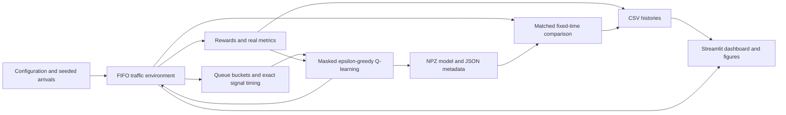
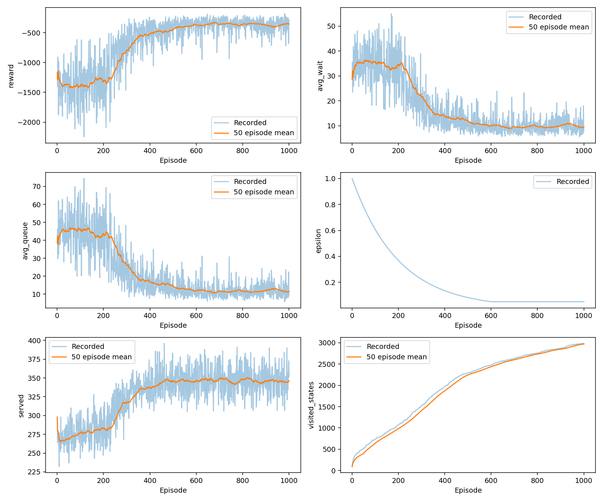
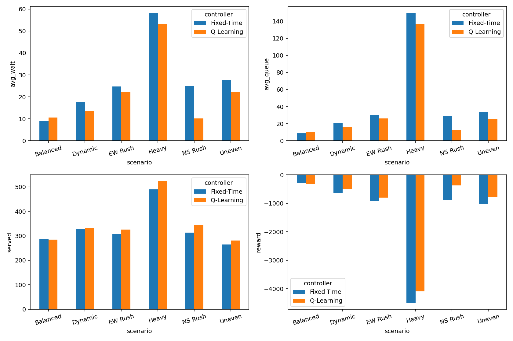

# 1. Title page

**SmartFlow AI: Intelligent Traffic Signal Optimization Using Reinforcement Learning**

Assessment Task 2: RL Innovation Hackathon — Build an Intelligent Learning Agent.
Sidharth P Nair · RA2311026050087 · Reinforcement Learning.
B.Tech Computer Science and Engineering (Artificial Intelligence and Machine Learning).
SRM Institute of Science and Technology, Tiruchirappalli.
Additional team details: editable in the dashboard and `team.json`.

# 2. Abstract

SmartFlow AI investigates whether tabular reinforcement learning can reduce delay
at a simulated four-way intersection under uneven traffic demand. The environment
generates seeded Poisson arrivals, maintains first-in-first-out vehicle queues and
enforces minimum green, maximum green, yellow and all-red intervals. A Q-learning
agent observes discretized queues and signal timing, then chooses between keeping
the current phase and requesting a switch. Its reward penalizes queued vehicles
and phase changes. The Python implementation uses NumPy, Pandas, Streamlit and
Plotly and requires no GPU or external dataset. Training comprised 1,000 episodes
of 300 seconds on north–south rush-hour demand, producing 300,000 updates. Mean
training reward improved from −1384.677 in the first 100 episodes to −371.261 in
the last 100. Evaluation used 20 unseen, matched arrival seeds per scenario. On
north–south rush-hour traffic, mean total queue fell from 29.346 to 12.113 vehicles,
a 58.73% reduction relative to fixed timing. Balanced-demand queue length instead
increased by 19.63%, demonstrating limited generalization. The dashboard exposes
real training, deterministic evaluation, model inspection and live schematic
simulation. These findings support educational experimentation rather than
real-world deployment or a claim of universally optimal control.

# 3. Introduction

Traffic queues form when arriving vehicles cannot immediately receive service.
Signal timing allocates that service across conflicting movements. Adaptive control
can respond to observed conditions, but its benefits depend on demand and modeling
assumptions. This project studies one controllable intersection with two compatible
movement groups and a small, explainable learning algorithm.

# 4. Problem statement

A fixed equal green split can waste service on quiet roads while busy approaches
accumulate vehicles. Learn when to retain or switch green, respecting clearance and
duration constraints, and measure whether the learned policy improves on a
conventional 15-second fixed-time baseline.

# 5. Objectives

- Minimize cumulative queueing delay under safe simulated signal rules.
- Reduce served-vehicle waiting time and queue size, preserve throughput and avoid
  unnecessary switching.
- Produce reproducible learning, honest comparison and a usable local demonstration.

# 6. Existing system

The implemented baseline alternates 15-second greens with the same two-second
yellow and one-second all-red clearance as the learning controller. It observes
phase time but ignores demand. It is a specific baseline, not a representation of
all modern traffic-control systems.

# 7. Proposed system

A tabular Q-learning controller estimates discounted return from environment
interactions. Exploration chooses random legal actions; exploitation chooses learned
high-valued actions. Neither training nor evaluation contains a longer-queue
switching heuristic. The environment, not the agent, enforces signal safety.

# 8. System architecture

# 9. RL formulation

Agent: the signal controller. Environment: four incoming approaches, stochastic
arrivals and two nonconflicting phases. Actions: keep (0), request switch (1).
State: queue buckets for N/S/E/W; current phase; exact elapsed green; transition
countdown. Buckets are 0–3, 4–7 and 8+. Default Cartesian state count is
`3^4 × 2 × 31 × 4 = 20,088`; Q has 40,176 scalar entries (about 314 KiB float64).
Some states are unreachable. During clearance the old phase and countdown uniquely
identify the target and yellow/all-red status. Exact timing preserves legal-action
information; aggregated queues and hidden changing arrival rates still introduce
state aliasing. Thus this is an approximate state representation, not an exact MDP.

Reward: `r = −0.1 × sum(post-service queues) − 0.5 × switch_initiated`.
Accumulated queue penalty approximates delay; no identical waiting penalty is added.
The policy aims to maximize discounted return, thereby favoring lower queues with
a switching cost. Episode windows are 300 seconds. The horizon emits
`terminated=False, truncated=True`; no physical terminal state exists normally.

# 10. Algorithm

`Q(s,a) ← Q(s,a) + α[r + γ max_{b∈valid(s')} Q(s',b) − Q(s,a)]`.
For a true terminal transition use target `r` only. Time-limit truncations bootstrap
because the task is treated as continuing; the training loop still resets after the
window. This assumes continuation value despite reset sampling, a limitation.

Starting from zeros, each step selects an epsilon-greedy legal action, advances the
environment and updates the applied action. Invalid future actions never enter the
Bellman maximum. Random tie-breaking is used while training. Evaluation uses no
exploration and chooses the first legal maximum consistently. Epsilon decays once
per completed episode to a floor of 0.05. See the original [Q-learning paper](https://doi.org/10.1007/BF00992698).

# 11. Methodology

First implement and test traffic dynamics, then validate agent updates and
persistence. Train on seeded interactions and save episode metrics. Evaluate both
controllers on copies of pre-generated traffic traces using disjoint seeds.
Finally connect the same state to the dashboard and produce charts from saved CSVs.
Each stage and failure is recorded in `PROGRESS.md`. Git metadata writes were
denied; the user subsequently removed the commit requirement, so development
continued without repeated Git attempts.

# 12. Implementation

`environment.py` maintains FIFO vehicle IDs and arrival/departure timestamps.
One second begins with arrivals and then serves compatible green approaches.
No service occurs during yellow/all-red. New arrivals can depart immediately.
Green bounds are enforced even if a controller requests an illegal action.

`q_learning_agent.py` validates and flattens states, masks actions, updates values,
decays epsilon and saves structured NPZ data without pickle. Metadata is embedded
for self-contained loading and also exported to JSON. `training.py` saves completed
episode rows immediately and checkpoints the model every 50 episodes and on handled
interruption. `evaluation.py` records trace hashes, means, standard deviations and
paired-difference standard errors. `visualization.py` renders one rectangle per
queued vehicle and actual last-step departure labels. Streamlit session state and
timed fragments preserve simulation state without a blocking animation loop; see
[official fragment behavior](https://docs.streamlit.io/develop/api-reference/execution-flow/st.fragment).

# 13. Experimental setup

| Setting | Value |
|---|---|
| Training demand | NS Rush |
| Episodes / duration | 1,000 / 300 seconds |
| Training seeds | 42–1041; controller RNG seed 42 |
| Alpha / gamma | 0.1 / 0.95 |
| Epsilon initial / floor / decay | 1.0 / 0.05 / 0.995 |
| Green minimum / maximum | 5 / 30 seconds |
| Yellow / all-red | 2 / 1 seconds |
| Service | 1 vehicle/second per compatible green approach |
| Evaluation | 20 seeds per scenario, 100000–100019, 300 seconds |
| Baseline | 15-second greens, same safety and service |
| Execution | Python 3.13.2, CPU; no external data |

Poisson rates N/S/E/W: Balanced (.25,.25,.25,.25), NS Rush (.48,.48,.12,.12),
EW Rush (.12,.12,.48,.48), Uneven (.60,.16,.10,.22), Dynamic swaps NS Rush
to EW Rush halfway through, Heavy (.65,.65,.65,.65). Heavy is deliberately
overloaded (2.6 arrivals/s > ideal service capacity 2/s). Other scenarios admit
appropriate phase allocations, although the equal-split baseline may not.

# 14. Results and analysis

Training performed 300,000 real updates, reached 2,985 distinct states and changed
3,720 Q entries. Final epsilon is 0.05. First/last 100 mean reward:
−1384.677 / −371.261. Last-100 mean total queue: 12.0564 vehicles.
These windows confound trace variation and reduced exploration; the paired
greedy-policy comparison supplies the baseline evidence.

| Scenario | Fixed queue | RL queue | Reduction | Fixed wait (s) | RL wait (s) | Fixed served | RL served |
|---|---:|---:|---:|---:|---:|---:|---:|
| Balanced | 8.749 | 10.467 | −19.63% | 8.901 | 10.605 | 287.35 | 284.50 |
| NS Rush | 29.346 | 12.113 | 58.73% | 24.860 | 10.228 | 312.60 | 342.40 |
| EW Rush | 30.170 | 26.239 | 13.03% | 24.672 | 22.250 | 306.85 | 325.10 |
| Uneven | 33.431 | 25.527 | 23.64% | 27.756 | 22.072 | 264.60 | 280.95 |
| Dynamic | 20.906 | 16.123 | 22.88% | 17.639 | 13.556 | 328.45 | 333.15 |
| Heavy | 149.673 | 136.474 | 8.82% | 58.257 | 53.304 | 489.90 | 522.70 |

For NS Rush, remaining vehicles averaged 42.75 versus 12.95; maximum total queue
53.75 versus 28.95; cumulative reward −888.39 versus −372.25; initiated switches
16 versus 17.75. The paired RL-minus-fixed queue difference was −17.2338 with
standard error 1.6848 vehicles across 20 seeds. These summaries describe finite
simulator trials, not a guarantee for future conditions. Full results and uncertainty
are in the adjacent CSVs; no adverse scenario was removed.

Average queue is the time average of **total** post-service queued vehicles.
Waiting is measured only for departed vehicles; the UI labels no-departure cases.
Remaining counts and unresolved queued-vehicle delay are reported separately.
Throughput is completed vehicles in the common fixed-duration window.
Lower-is-better reduction is `(fixed − RL)/abs(fixed) × 100`; higher-is-better
metrics reverse the numerator. A zero denominator gives zero only when both values
are zero, otherwise an undefined percentage, never a fabricated improvement.

# 15. Observations

Training improved its measured return while exploration decreased. NS Rush gains
were accompanied by higher throughput and fewer unresolved vehicles, reducing the
risk of misleading served-only wait statistics. Balanced traffic worsened, consistent
with specialization, coarse queue abstraction and limited state coverage. Dynamic
maximum queues also worsened despite improved mean queues. Heavy demand remained
unstable even though the learned policy served more vehicles. No universal
superiority or convergence claim is supported.

# 16. Limitations

Single intersection, straight-through service, no turns, pedestrians, travel times,
spillback, finite road storage, emissions or real traffic validation. Coarse buckets
lose exact queue lengths; demand shifts are unobserved. Constant learning rate,
finite coverage and reset sampling do not meet an unconditional optimality guarantee.
Saved models support inference but not exact mid-run RNG continuation. Browser
layout, downloads and wall-clock playback require manual verification.

# 17. Future scope

Proposed, not implemented: DQN, multi-agent coordinated intersections, real datasets,
traffic-camera observations, emergency priority and SUMO integration. A stronger
study would tune baselines, train/evaluate multiple independent learner seeds,
reserve validation traces separately, compare state abstractions and test robustness
before considering any real-world use.

# 18. Conclusion

The completed project demonstrates real masked Q-learning, persisted learning
history and a reproducible local dashboard. The included NS-rush-trained controller
reduced NS Rush mean queue by 58.73% against the stated fixed-time baseline, while
performing worse on Balanced demand. Both findings are retained and explain the
benefit and limitations of a specialized tabular policy.

# 19. References

- Watkins, C. J. C. H. & Dayan, P. (1992). *Q-learning*. Machine Learning 8,
  279–292. [Publisher / DOI](https://doi.org/10.1007/BF00992698).
- Sutton, R. S. & Barto, A. G. (2018). *Reinforcement Learning: An Introduction*,
  second edition, MIT Press. [Authors' book page](http://incompleteideas.net/book/the-book-2nd.html).
- [NumPy documentation](https://numpy.org/doc/), [Pandas documentation](https://pandas.pydata.org/docs/),
  [Streamlit documentation](https://docs.streamlit.io/), [Plotly Python documentation](https://plotly.com/python/),
  [Matplotlib documentation](https://matplotlib.org/stable/), [pytest documentation](https://docs.pytest.org/).

# 20. Team contributions

| Name | Registration | Actual contribution (complete before submission) |
|---|---|---|
| Sidharth P Nair | RA2311026050087 | |

Add real additional members and contributions in Project Information / `team.json`.
Implementation and documentation were prepared with a coding assistant. Student
contributions are intentionally left unassigned rather than invented.
